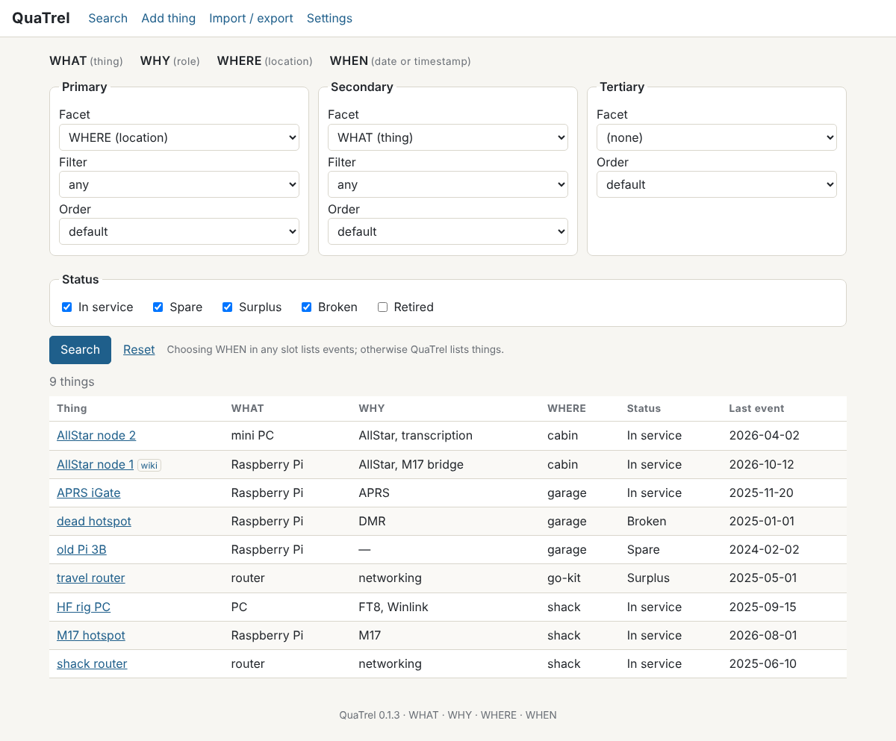
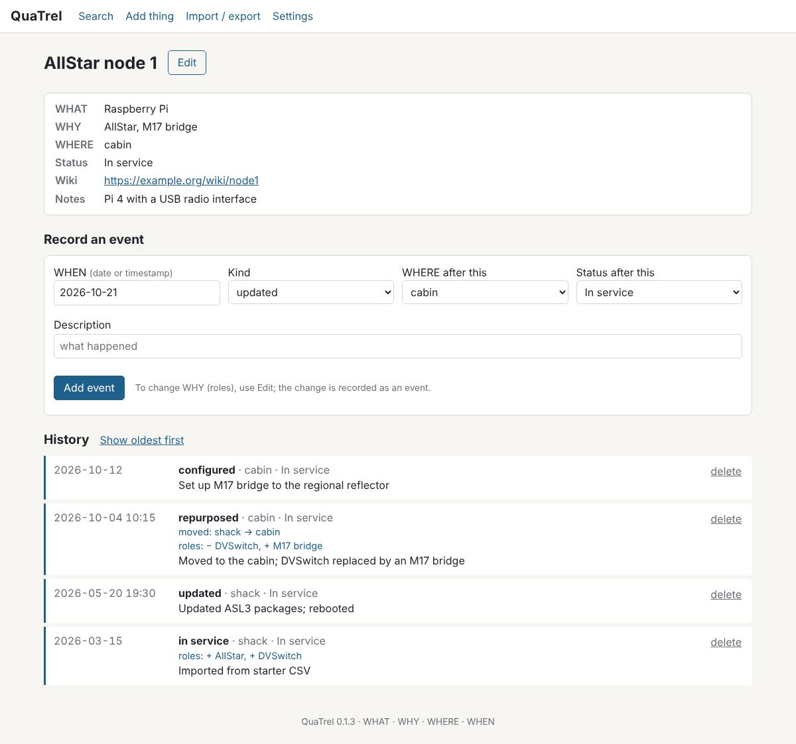

# QuaTrel

**A four-facet equipment log for hams, makers, and homelabbers.**

**Version:** 0.1.3 · **License:** MIT · **Pronounced:** KWAH-trel (from *quaternary* + *relational*)



If you run a few nodes, hotspots, radios, and computers across a shack, a garage, and maybe a second location, you already know the questions:

- Which of my boxes run AllStar, and where are they?
- Do I have a spare Raspberry Pi, and which house is it in?
- What did I change on my gear last month?
- When did that router move, and what was it doing before?

QuaTrel answers them by recording every thing you own along four independent facets:

| Facet | Meaning | Examples |
|---|---|---|
| **WHAT** (thing) | The hardware | router, Raspberry Pi, PC, hotspot |
| **WHY** (role) | What it's used for | AllStar, M17, networking, APRS |
| **WHERE** (location) | Where it is | shack, garage, lake house |
| **WHEN** (date or timestamp) | When something happened to it | 2026-10-21, or 2026-10-21 14:30 |

A separate **status** (In service, Spare, Surplus, Broken, Retired) makes unused gear as easy to find as gear in service, because a spare is valuable precisely because it *could* be used.

To search, choose up to three facets as primary, secondary, and tertiary, each with an optional filter and its own sort order. "WHY = AllStar, then WHERE" lists your AllStar nodes grouped by location. "WHEN in September, newest first" lists everything you did that month. Every search lives in the page's address, so the ones you use often can be bookmarked.



Every thing keeps its full history. Moving it, changing its roles, or changing its status records an event automatically, so the history page shows "moved: shack → garage" or "roles: + AllStar, − APRS" right where it happened.

QuaTrel is meant to sit beside a wiki, not replace one. It holds the structured facts; your wiki holds the prose. Each thing can link to its own wiki page.

## Getting started in five minutes

The easiest on-ramp is a spreadsheet:

1. Install and start QuaTrel (below).
2. Go to **Import / export** and download the starter template.
3. Fill in one row per thing: name, what, why, where. Several roles go in one cell separated by semicolons, like `AllStar; DVSwitch`. Dates can be typed as `20261021`, which spreadsheets never reformat.
4. Save as CSV and import it. QuaTrel shows a preview, including every new WHAT, WHY, and WHERE value it will create, so you can catch "Lake House" vs. "lake house" before it becomes two places.

Each imported thing gets a starting event, so the next thing you record (a firmware update, a move, a repair) begins its real history.

## Requirements

- Python 3.9 or newer
- Flask and waitress (installed below)
- Any modern browser; pages work on phones and follow your light or dark mode

All data lives in one SQLite file.

## Install and run on Windows

Keep QuaTrel *out* of OneDrive or any other cloud-synced folder; syncing a live database file can damage it. The steps below use a `quatrel` folder in your user folder.

1. Download this repository as a zip (green **Code** button → **Download ZIP**) and extract it to `C:\Users\YOURNAME\quatrel`, so `app.py` sits directly inside that folder.
2. Open **Windows PowerShell** and run each command in turn:

```powershell
cd $HOME\quatrel
python -m venv .venv
.\.venv\Scripts\python.exe -m pip install -r requirements.txt
.\.venv\Scripts\python.exe app.py
```

3. Open http://127.0.0.1:5000 in your browser.
4. To stop QuaTrel, click in the PowerShell window and press Ctrl+C. To start it again later, open PowerShell and run the `cd` line and the last line again.

## Install and run on Linux or macOS

```bash
git clone https://github.com/EtherHamRadio/quatrel.git
cd quatrel
python3 -m venv .venv
.venv/bin/python -m pip install -r requirements.txt
.venv/bin/python app.py
```

Then open http://127.0.0.1:5000.

## Running QuaTrel for your whole home network

QuaTrel runs nicely as a service in a small Linux container, for example a Debian 13 LXC on Proxmox, so every computer on your LAN (or your VPN) can reach it. The `deploy` folder has a systemd service file, an example settings file, and a step-by-step guide: [`deploy/quatrel-proxmox-install-v1.1.md`](deploy/quatrel-proxmox-install-v1.1.md).

## Settings

Set these environment variables before starting, if needed:

| Variable | Default | Purpose |
|---|---|---|
| `QUATREL_DB` | `quatrel.db` next to `app.py` | Where the database lives |
| `QUATREL_HOST` | `127.0.0.1` | `0.0.0.0` makes QuaTrel reachable from other computers |
| `QUATREL_PORT` | `5000` | Port |
| `QUATREL_PASSWORD` | (none) | A shared password; any user name works. Strongly recommended on a network |

## Security

- QuaTrel has no user accounts. On a shared network, set `QUATREL_PASSWORD`.
- Never expose QuaTrel directly to the internet. For access away from home, use a VPN such as Tailscale or WireGuard.
- Changes are accepted only from QuaTrel's own pages, so a web page in another browser tab can't make changes behind your back.
- Values are always passed to the database as parameters and escaped on display; wiki links must be `http://` or `https://`; JSON restores accept only QuaTrel's own columns.

## Backups

**Import / export → JSON backup** saves everything in one file, which **Restore** can bring back. You can also copy the database file while QuaTrel is stopped.

## Documentation

- [`docs/quatrel-spec-v0.4.md`](docs/quatrel-spec-v0.4.md): the full specification, including the data model and the rules for automatic events.
- [`CHANGELOG.md`](CHANGELOG.md): what changed in each version.

## Feedback

QuaTrel grew out of one ham's need to keep track of gear spread across two homes. If you try it, I'd like to hear what works and what doesn't: open an issue here on GitHub. Ideas already on the list include a sample vocabulary for new users and a way to track parts of assemblies (a node built from a Pi, a hub, and a radio interface).

73,
Tom Salzer, KJ7T · [EtherHam](https://etherham.com)
